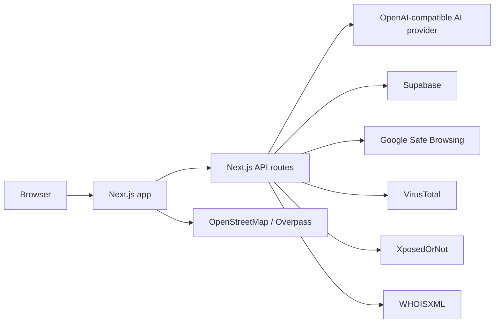

<div align="center">

# Smart Bharat

Smart Bharat is a public-facing civic and cyber-safety web app that brings emergency guidance, scam awareness, complaint helpers, scheme information, security checks, nearby-service discovery, and a Cyber Awareness Academy into one browser-based experience.

[Live site](https://www.smartbharat.me)

</div>

## Features

- Emergency helpline cards, quick call actions, Panic Mode, location fallback, nearby services, and an ICE Card.
- Scam ticker, community scam reports, an AI Companion with a local fallback response, and an urgent cyber-fraud checklist.
- Complaint drafting, category-specific official portal links, local complaint history, and informational complaint tracking.
- Scheme eligibility search, civic topic guides, and a visitor counter.
- URL safety checks using local heuristics plus optional Google Safe Browsing and VirusTotal results.
- Email breach checks through XposedOrNot, password k-anonymity checks through Have I Been Pwned, WHOIS lookups through WHOISXML, and IP intelligence.
- Cyber hygiene scoring, QR scanning, and nearby-service maps using OpenStreetMap/Overpass.
- A ten-question Cyber Awareness Academy quiz, score-based certificate downloads, and stateless certificate verification.
- Responsive light/dark/high-contrast UI, reduced-motion ticker behavior, offline emergency fallback, and installable web-app assets.

## Architecture



The current AI route calls the OpenAI-compatible chat-completions endpoint and reads `OPENAI_API_KEY`; the source does not currently call Groq or read `GROQ_API_KEY`. Overpass is called from the browser-side nearby-services map rather than through an API route.

## Technology

- Next.js App Router, React, TypeScript, and Tailwind CSS.
- `@sentry/nextjs` for optional error monitoring.
- Supabase JavaScript client for scam reports and URL-scan caching.
- Leaflet and React Leaflet for maps.
- QR Scanner, QRCode, and jsPDF for QR and certificate features.
- Playwright and axe-core for the smoke and accessibility checks.

## Security and privacy design

- There are no user accounts or central user profiles.
- API inputs are validated for type, length, allowed values, URL scheme, and email shape where applicable.
- Selected API routes use in-memory, request-fingerprint-based rate limiting. This is per process and is not a distributed limiter.
- The app sends security headers including a Content Security Policy, frame protection, MIME-sniffing protection, HSTS, and a strict referrer policy.
- Certificate IDs are signed with HMAC when `CERT_SIGNING_SECRET` is configured. Verification recomputes the signature and checks the score and issued date; it does not verify the certificate name and does not use a certificate database.
- Browser-only data can include theme and accessibility preferences, emergency contacts, last-known location, offline alert queue, ICE Card data, complaint history, quiz best score, tool history, feedback, and local rate-limit records. The Privacy page provides a clear-data action.
- The certificate name is used for the downloaded certificate and is not stored or sent to the server.
- Community reports are sent to Supabase after validation; contact information is masked before insertion, while the report category and description are retained for the public-report feature.
- URL scan results may be cached in Supabase for up to 48 hours. Other security checks call their provider or run locally in the browser.
- Optional Sentry monitoring is disabled without a DSN, does not send default personal information, and strips request bodies, query strings, and user-entered text when enabled.

## Environment variables

All values are optional at build time. Features that require a missing value return a fallback, an unavailable/not-configured state, or a provider error rather than exposing a key to the browser. `NEXT_PUBLIC_*` values are intentionally public and must never contain secrets.

| Variable | Scope | Required? | What breaks or changes without it |
|---|---|---:|---|
| `OPENAI_API_KEY` | Server | Optional | The AI Companion uses its built-in Hinglish safety fallback instead of the remote model. |
| `OPENAI_MODEL` | Server | Optional | The AI route uses its default model name. |
| `NEXT_PUBLIC_SUPABASE_URL` | Public | Optional | Community reports and URL-scan caching are unavailable without a Supabase URL. |
| `NEXT_PUBLIC_SUPABASE_ANON_KEY` | Public | Optional | Community reports and browser-side Supabase access are unavailable without the anonymous key. |
| `SUPABASE_SERVICE_ROLE_KEY` | Server | Optional | URL scanning falls back to the public Supabase key; it has no effect if Supabase is otherwise unavailable. |
| `GOOGLE_SAFE_BROWSING_API_KEY` | Server | Optional | URL checks report Safe Browsing as not configured. |
| `VIRUSTOTAL_API_KEY` | Server | Optional | Deep VirusTotal results are unavailable. |
| `WHOISXML_API_KEY` | Server | Optional | WHOIS lookup returns a not-configured response. |
| `CERT_SIGNING_SECRET` | Server | Optional | Certificates use the legacy local ID format and verification remains format-only. |
| `APP_URL` | Server | Optional | CORS uses the request origin unless this server-side application URL is configured. |
| `NEXT_PUBLIC_APP_URL` | Public | Optional | CORS uses `APP_URL` or the request origin; certificate links still use the configured site URL in the certificate component. |
| `SENTRY_DSN` | Server | Optional | Server-side Sentry monitoring is disabled. |
| `NEXT_PUBLIC_SENTRY_DSN` | Public | Optional | Client-side Sentry monitoring is disabled unless the server DSN is also used by the client configuration. |

The repository’s example environment file may contain a placeholder `GROQ_API_KEY` for compatibility with earlier setup notes, but the current source does not read it.

## Local setup

```bash
git clone https://github.com/kunalkushwaha-tech/Smart-Bharat-App.git
cd Smart-Bharat-App/web
cp .env.local.example .env.local
npm ci
npm run dev
```

Open the local URL printed by Next.js. Optional provider keys can be added to `web/.env.local`; do not commit that file or any real credentials.

Useful checks:

```bash
npm run lint
npx tsc --noEmit
npm run build
npm run smoke
```

## Limitations and disclaimer

- The in-memory rate limiter is process-local; it is not suitable as a distributed production limiter without a shared store.
- Certificate verification proves the signed score and issued date when signing is configured. It does not prove the name printed on a certificate.
- Provider availability, quotas, response quality, browser permissions, and map coverage can affect results.
- AI guidance and automated checks may be inaccurate; use the relevant official service for emergencies and final decisions.
- Smart Bharat is not affiliated with any government agency.
